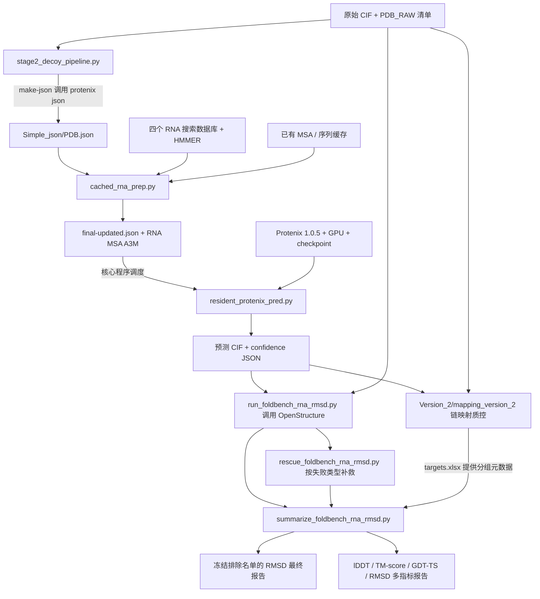

**predict_protenix 文件分类、调用关系与产出说明**

核对日期：2026-11-10。范围：`Code/predict_protenix`，包含根目录、Version_2、Version_3、历史备份与环境材料。依据为当前代码、参数定义、写文件逻辑和文件内容比较；未启动服务器任务、未运行预测、未重新计算评估指标。下文的数量是配置预期，不代表服务器已经完成的实际数量。

本次只新增本说明和同目录的 `PREDICT_PROTENIX_FILE_INVENTORY_20261110.tsv`；两者均可直接删除，不影响程序。未移动、删除或修改已有文件。逐文件索引包含当前目录下的缓存、备份和环境材料。

**1. 整体关系**



这是数据流图，不表示每个节点都会被自动顺序运行。`start_*.sh` 是启动入口，`run_*.sh` 固定路径与实验参数，Python 程序完成处理，`monitor_*.sh` 读取运行状态。链映射 TSV 不会自动传给当前 OpenStructure runner；汇总脚本读取的是 mapping 分支的 `targets.xlsx`，用于日期和链数等元数据。

与 Download_PDB_RAW 的关系：这里使用的是其 `pdb_cif_pipeline.py` 能生成的 `pdb_cif_manifest.csv`、`rna_chain_sequences.csv` 和原始 CIF。这里不直接读取 `rna_entity_metadata.xlsx`，也不会自动运行下载程序。启动脚本要求这些清单位于 `~/Code/pipeline_reports/PDB_RAW/`，需要事先放到相应位置。

**2. 共用核心与预处理：优先理解这三个 Python 文件**

| 文件 | 职责和依赖关系 | 结果/产出 |
|---|---|---|
| `stage2_decoy_pipeline.py` | 全流程调度与审计；提供 preflight、audit、make-json、prep、pred；pred 通过子进程启动 resident worker | 按子命令生成输入 JSON、MSA/prep、预测结构，或审计报告；详见后文 |
| `cached_rna_prep.py` | 导入 stage2_decoy_pipeline；以唯一 RNA 序列为单位复用已有有效 MSA、命中缓存或调用 protenix prep；官方预计算 MSA 仅显式开启时使用 | `Simple_json/<pdb>-final-updated.json`；共享缓存中的 `rna_msa.a3m`；`Complex_json/prep_output_<pdb>/.../rna_msa/<index>/rna_msa.a3m` 兼容链接；缓存使用报告、心跳和日志 |
| `resident_protenix_pred.py` | 通过 Protenix 官方 runner API 运行模型，常驻加载后处理多个目标；由核心程序设置 GPU 并启动 | 每个 PDB、每个 seed 的预测 CIF、summary-confidence JSON；启用 `--need-atom-confidence` 时还要求完整 full-data JSON；另有 worker 输入、失败日志和心跳 |

`stage2_decoy_pipeline.py` 的子命令：

| 子命令 | 行为 | 主要输出 |
|---|---|---|
| `preflight` | 检查 Protenix、工具、数据库、checkpoint 和路径 | 报告目录下 `preflight.csv` |
| `audit` | 清点并校验已有 JSON、prep、各 seed 输出 | `decoy_manifest.csv`、`decoy_seed_manifest.csv`、有可用链信息时的 `chain_id_mapping.csv`、`decoy_report.xlsx`、`summary.json` |
| `make-json` | 对没有被索引到原始 JSON 的目标调用 `protenix json` | `Simple_json/<pdb>.json`；命令日志及更新后的审计报告 |
| `prep` | 按 PDB 调用 `protenix prep` | prep 输出和 final-updated JSON；日志及审计报告 |
| `pred` | 先检查 prep 与 seed 完整性，再将缺失 seed 分配给 GPU worker | CIF/confidence、`pred_availability.csv`、`pred_deferred_prep.csv`、`pred_quarantined_oom.csv`、`pred_scheduled.csv`、批量输入 JSON、日志、心跳及审计报告 |

常用 `run_foldbench_stage1.sh prep` 实际走的是 `cached_rna_prep.py`，不是核心程序的逐 PDB `prep` 子命令。缓存 prep 额外生成 `rna_msa_cache_usage.csv`、`rna_msa_cache_summary.json`。完整 prep 会在审计后跳过；不完整项可能备份后补写。

**3. 启动器按实验分类，不要仅凭 Version 文件夹判断用途**

| 实验 | 文件 | 输入与主要输出 |
|---|---|---|
| FoldBench 5×5：预处理 | 根目录 `run_foldbench_stage1.sh`、`start_foldbench_prep.sh`；`Version_2/prep_version_2/` 的三个 shell 文件 | 固定输入清单与数据库；输出 Simple_json、Complex_json、共享序列缓存；日志在 `FOLDBENCH_STAGE1/prep_runs/<run>/` |
| FoldBench 5×5：预测 | 根目录 `run_foldbench_pred.sh`、`start_foldbench_pred.sh`；`Version_2/foldbench_55_version_2/` 的三个 shell 文件 | 5 seeds：42、66、101、2024、8888；每 seed 5 samples；预测写入 `~/Json_data/Foldbench_predictions`，运行报告在 `FOLDBENCH_STAGE1/pred_runs/<run>/` |
| 旧 Data 划分：train 50×4 | 根目录及 `Version_2/train_504_version_2/` 的 `start_train_50x4_8gpu.sh` | 依赖原始清单、2227 过滤清单、旧划分 final_manifest.tsv、此前补跑的 decoy_manifest.csv、Data/train 和完成的 prep；写入 `Foldbench_predictions_50x4_train` |
| 旧 Data 划分：val/test 50×4 | 根目录及 `Version_2/train_504_version_2/` 的 `start_eval_50x4_6gpu.sh` | 依赖旧划分和 train 运行产生的 all_excluded_ids.txt；写入 `Foldbench_predictions_50x4_val`、`Foldbench_predictions_50x4_test` |
| Data_V1：50×4 + 完整置信度 | `Version_3/data_v1_50x4_confidence/` 下的 prepare Python、start/run/monitor shell、README | 从 Data_V1 划分和已完成 prep 构造 split manifests，调用根目录核心与 resident worker；直接写入 `~/Data_V1/<train或val或test>/<pdb>/seed_<seed>/predictions/` |

这里的 `train`、`eval` 指目标属于哪个数据集：上述脚本都在做 Protenix 推理，不训练新模型，也不在这些启动器中计算 RMSD。`50×4` 是 50 个 seed、每 seed 4 个 sample，不是 50 个目标或 GPU 数。

各实验共用 `protenix_base_default_v1.0.0`，推理使用 200 steps、10 cycles、BF16，RNA MSA 开启、template 关闭。5×5 的全量设计目标为 2241×25=56,025 个主预测 CIF；隔离/失败后实际数量以审计为准。旧 Data 的 50×4 使用 seeds 300–349，目标数先按历史清单筛选再计算，不能直接用 2241×200。

旧 train 启动器检查原 train 为 1795 个、原始/过滤清单差集为 14 个，并验证某次补跑为 10 个目标中 6 成功、4 失败；旧 eval 启动器检查 val=116、test=101。这些是特定历史实验约束，不是通用数据划分器。其排除集合的一部分直接写在 shell 内嵌 Python 中。

Data_V1 分支的各文件：

| 文件 | 职责 | 产出 |
|---|---|---|
| `prepare_data_v1_confidence_run.py` | 核对主清单、split KEPT 行、Data_V1 目录、输入 JSON 和 prep；可接受新划分计数和目标子集参数 | `<split>_50x4_confidence_manifest.csv`、`eligible_<split>_pdb_ids.txt`、`smoke_manifest.csv`、`selection_summary.json` |
| `start_data_v1_50x4_confidence_8gpu.sh` | 预检 GPU、内存、磁盘、核心脚本接口；生成 seeds；调用 prepare；默认先跑 1 target×1 seed×4 samples 冒烟，再后台启动 run | seeds.txt、选择清单、smoke 结果、运行目录、启动日志和 PID |
| `run_data_v1_50x4_confidence.sh` | 按 train/val/test 分轮调用 stage2 的 pred，设置 dataset 输出布局与完整置信度，进行资源保护 | 结构和置信度文件、各 split/round 审计日志、退出码与可能的 resource_guard_stop.txt |
| `monitor_data_v1_50x4_confidence.sh` | 查看该运行的 PID、日志、资源和进度 | 终端状态，无新增结构预测 |
| `README.md` | 实验说明 | 无运行数据产出 |

该分支默认是 train=774、val=117、test=97，共 988 个目标，每个 200 个结构，预期 197,600 个主 CIF；每个 sample 同时对应 summary-confidence 和 full-data JSON。full-data 要求五个字段：`atom_plddt`、`token_pair_pae`、`token_pair_pde`、`contact_probs`、`atom_to_token_idx`。当前代码的断点检查采用字段扫描和末尾完整性检查，不是对大 JSON 的完整数值质量验证。Version_3 是脚本版本目录，其默认数据集仍叫 Data_V1。

**4. 预测文件具体长什么样**

传统布局（根目录 5×5 和旧 Data 50×4）：

```text
<预测根目录>/pred_output_<pdb>_seed_<seed>/<pdb>/seed_<seed>/predictions/
    <pdb>_sample_<n>.cif
    <pdb>_summary_confidence_sample_<n>.json
    <pdb>_full_data_sample_<n>.json     # 完整置信度模式要求
```

Data_V1 的 dataset 布局：

```text
~/Data_V1/<split>/<pdb>/seed_<seed>/predictions/
    <pdb>_sample_<n>.cif
    <pdb>_summary_confidence_sample_<n>.json
    <pdb>_full_data_sample_<n>.json
```

`*_wounresol.cif` 若存在，不计作主预测 sample。summary-confidence 用于 ranking_score 等预测自评信息；full-data 包含逐原子和成对置信度；二者都不是对真实结构计算出的 RMSD 标签。这里的程序不负责生成下游训练用 `.pt` 数据集，也不输出微调后的模型 checkpoint。

**5. 质量检查与链映射**

| 文件 | 输入/关系 | 产出 |
|---|---|---|
| `deep_prep_audit.py` | 读取 PDB/链清单、原始 JSON、final JSON、A3M；默认检查当前集合与旧集合的交集，scope 可改 | `deep_prep_pdb_manifest.csv`、`deep_prep_rna_manifest.csv`、`deep_prep_summary.json`、`deep_prep_audit.xlsx`；不修改 prep 原文件 |
| `compare_cif_ids.py` | 对单个 GT 与预测 CIF 比较链、残基编号和序列；依赖 gemmi | 默认只打印比较结果；提供 `--json-output` 才保存 JSON；不改写 CIF |
| `Version_2/mapping_version_2/build_mapping_targets_xlsx.py` | 从预测目录发现目标，结合 date_audit.tsv 和 PDB manifest | 默认 `~/Json_data/mapping/xlsx/targets.xlsx`；含时间分组、链数等信息，mapping/review 状态初始留空 |
| `Version_2/mapping_version_2/build_chain_maps.py` | 读取 targets.xlsx、Simple JSON、GT CIF 和预测 CIF；展开 RNA 链并按序列匹配 | 默认 `~/Json_data/mapping/tsv/<PDB>/chain_map.tsv`，标记 PASS 或需要人工审核；不生成新结构 |
| `Version_2/mapping_version_2/resolve_chain_maps_by_coordinates.py` | 导入 build_chain_maps；在同序列副本等歧义场景下结合整体复合物坐标求链对应 | 保留基础 chain_map.tsv；生成 `<PDB>/chain_map_variants/mapping_01/chain_map.tsv` 等变体，以及 `<PDB>/chain_map.txt`，列出每个 candidate 适用的变体 |

坐标消歧默认使用 C4' 和整体刚体变换；后面的 OpenStructure 刚体 RMSD 报告按说明采用 C3'。这两种数值用途和口径不同，不能直接当成同一个指标。`chain_id_mapping.csv` 是核心审计的较简单序列映射，链映射分支的 chain_map.tsv 则包含更细致的质控；相同序列多副本的简单顺序假设不等于已完成坐标消歧。

**6. OpenStructure 评估与报告**

| 文件 | 职责/输入关系 | 主要输出 |
|---|---|---|
| `run_foldbench_rna_rmsd.py` | 发现传统 pred_output 布局的 sample CIF 和 summary ranking_score，对原始 GT 调用 `ost compare-structures` | 默认 `~/Json_data/Foldbench_evaluation/rmsd/` 下 `manifest/candidates.csv`、`details/<PDB>/seed_<seed>/sample_<n>.json`、errors、progress.json、run_summary.json、运行元数据与事件日志 |
| `rescue_foldbench_rna_rmsd.py` | 导入上一个 runner；只对已识别的 lDDT 空数组或 USalign No assignable chain 两类错误，另跑 rigid-only | 同一根目录下 `rigid_only_rescue/` 的 JSON、错误、进度和汇总；不覆盖标准结果 |
| `summarize_foldbench_rna_rmsd.py` | 读取 candidates 清单、标准/补救 JSON、targets.xlsx、输入 JSON；先按最高 ranking_score 选严格 rank-1 | `reports/all_candidates.csv`、`rank1_targets.csv`、`failed_candidates.tsv`、`rmsd_report.xlsx`、两张 RMSD PNG、分组统计 CSV、排除名单及审计表 |
| `build_foldbench_rna_rmsd_final_report.py` | 读取上述 all_candidates、rank1、审计信息与冻结的排除名单；不重跑 OST | 默认 `rmsd/final_report/` 下 `RNA_RMSD_final_report.xlsx`、tables、figures（PNG/PDF/SVG）、`frozen_excluded_pdb_ids.txt`、说明和 report_manifest.json |
| `build_foldbench_rna_multimetric_report.py` | 读取 rank1_targets.csv，以 lDDT 为主，汇总 TM-score、GDT-TS、C3' RMSD；不重跑 OST | 默认 `~/Json_data/Foldbench_evaluation/foldbench_style_multimetric_report/` 下 `FoldBench_style_RNA_multimetric_report.xlsx`、统计表、缺失指标表、代表案例表、三组 PNG/PDF/SVG 图及说明 |
| `start_foldbench_rna_rmsd.sh` | 后台启动上述各步骤；模式为 smoke、run、rescue、summarize、final-report、multimetric-report | `~/Code/pipeline_reports/FOLDBENCH_RNA_RMSD/runs/<时间_模式>/` 的命令、日志、PID、退出码 |
| `monitor_foldbench_rna_rmsd.sh` | 查看最新评估与报告步骤的状态 | 终端状态 |

严格 rank-1 是先按模型的 ranking_score 选候选，选中候选评估失败时不改选另一个“RMSD 更好”的候选。rigid-only rescue 只能补刚体 RMSD，缺失的 lDDT/TM-score 不会凭空恢复。最终 RMSD 报告使用排除名单；多指标报告直接读取严格 rank-1 全表并逐指标记录缺失，二者统计分母可能不同。

当前 runner 的候选发现基于 `pred_output_<PDB>_seed_<seed>` 布局，不能直接扫描 Data_V1 的 dataset 布局。mapping 的默认参数也针对 5×5；对 50×4 或 Data_V1 复用时需要检查参数与发现逻辑。

**7. 环境、清单、文档、测试和备份的分类**

| 文件/目录 | 分类与用途 | 产出或保留建议 |
|---|---|---|
| `protenix_env.sh` | 运行环境：设置持久化 Conda/CUDA/缓存路径，定义内存与状态文件辅助函数；被启动器 source | 环境变量和缓存目录，不生成结构；主流程必需 |
| `check_pred_environment.sh` | 环境诊断：进程、GPU、PyTorch/API、工具、checkpoint、目录可写性 | 终端检查结果；其 source 的环境脚本可能创建缓存目录 |
| `requirements_stage2_decoys.txt` | 调度/审计层依赖：pandas、openpyxl、gemmi | 安装说明，不是完整的 Protenix/GPU 环境 |
| `requirements_foldbench_rmsd_report.txt` | openpyxl、matplotlib | 安装说明；当前高级报告还直接依赖 pandas、numpy，不能认为仅安装此文件就足够 |
| `pred_oom_quarantine.txt` | 普通 5×5 队列使用的隔离配置；包含 OOM 目标和部分化学组分不兼容目标 | 输入清单，影响调度，不是预测输出 |
| `pred_abandoned_25.txt` | 25 个放弃目标的记录：12 个输入/CCD问题、13 个 OOM | 历史排除记录；旧 50×4 脚本内嵌了相应集合，不是自动读取此文件 |
| `README_PERSISTENT_CONDA.md` | 持久化 Conda 与资源策略说明 | 优先参考其环境说明，再与当前 shell 核对 |
| `README_FOLDBENCH_STAGE1.md` | 5×5 流程说明 | 部分 Docker/GPU/监控命令已与当前目录布局不同 |
| `README_STAGE2_DECOYS.md` | 早期 4 seeds×50 samples 流程说明 | 历史实验口径；当前核心默认已经是 5×5 |
| `README_FOLDBENCH_RNA_RMSD.md` | 评估协议、续跑、补救和报告说明 | 当前评估分支的参考文档 |
| `Version_2/tests/*.py` | 共七个单元测试：核心调度、缓存、prep审计、目标表、序列映射、坐标消歧、评估/报告 | 临时测试数据与测试结果；不是实验结果；部分导入路径仍依赖旧目录布局 |
| `Version_3/tests/test_prepare_data_v1_confidence_run.py` | Data_V1 选择清单构建测试 | 临时测试文件与测试结果 |
| `protenix_test.inspect.json` | 旧 Docker 容器 inspect 快照 | 历史环境记录，不是 RNA 输入 JSON |
| `protenix_test.pip-freeze.txt`、`protenix_test.portable-freeze.txt` | 旧环境依赖快照 | 复现参考，不是任务队列或预测结果 |
| `environment/protenix-1.0.5/` | 依赖约束、构建/快照、Protenix wheel、部分源码相关文档/示例/序列索引 | 环境复现材料；不应与本项目业务脚本或 RNA 预测结果混放理解 |
| `backups/before_conda_migration_20260813T110130Z/` | 五个迁移前脚本副本 | 历史备份，不是当前主入口 |
| `backups/before_conda_scripts_20260813T114924Z/` | 五个修改前脚本副本 | 历史备份，不是当前主入口 |
| `run_foldbench_stage1.sh.before_oom_20260810` | OOM 策略调整前的 shell 副本 | 历史备份 |
| 各级 `__pycache__/` | Python 自动生成的字节码缓存 | 可再生；不是源码或实验结果 |

外部运行环境：服务器 Linux、Bash、持久化 Conda Protenix 1.0.5、PyTorch/CUDA 与 GPU、模型 checkpoint 和 common 化学组分等文件、四个 RNA 数据库、HMMER（nhmmer/hmmalign/hmmbuild）；环境检查还检查 kalign、nvcc、flock。后台资源调度还使用 setsid、nvidia-smi 和 Linux cgroup/proc。评估需要提供 `ost compare-structures` 的 OpenStructure 环境，文档固定 2.8.0；runner 自身不会通过版本比较强制锁定为 2.8.0。报告层主要依赖 pandas/numpy/openpyxl/matplotlib，坐标映射依赖 gemmi/numpy/openpyxl。

**8. 已确认的重复与布局问题**

逐字节比较确认以下六组内容完全相同：

| 根目录文件 | 同内容副本 |
|---|---|
| `run_foldbench_stage1.sh` | `Version_2/prep_version_2/run_foldbench_stage1.sh` |
| `start_foldbench_prep.sh` | `Version_2/prep_version_2/start_foldbench_prep.sh` |
| `run_foldbench_pred.sh` | `Version_2/foldbench_55_version_2/run_foldbench_pred.sh` |
| `start_foldbench_pred.sh` | `Version_2/foldbench_55_version_2/start_foldbench_pred.sh` |
| `start_train_50x4_8gpu.sh` | `Version_2/train_504_version_2/start_train_50x4_8gpu.sh` |
| `start_eval_50x4_6gpu.sh` | `Version_2/train_504_version_2/start_eval_50x4_6gpu.sh` |

这些 Version_2 shell 内仍指向服务器根目录的 `~/Code/predict_protenix/...`，没有形成完全独立的第二套核心代码。四个 monitor（prep、pred、train50×4、eval50×4）只存在于 Version_2 子目录，但多个根目录启动器/旧 README 给出的监控命令指向根目录；在当前本地布局下路径不对应，需要部署时调整。

服务器脚本大量固定 `/storage9920/home/tinghao.xia`，并依赖当时的清单和实验状态；不能在当前 Mac 路径下原样运行。`start_foldbench_rna_rmsd.sh final-report` 还固定校验 2199 总目标、32 排除、2167 有效；multimetric-report 固定期望 2199 个目标。这是历史报告的验收数字，不是对新实验可直接沿用的数量。

**9. 分类整理建议与运行顺序**

推荐按“用途＋实验配置”建立索引：共用核心、预处理、5×5 入口、旧 Data 50×4 入口、Data_V1 完整置信度入口、质控/链映射、评估/报告、环境、测试、历史备份。不要把 Version_2、Version_3 自动等同于 Data_V2、Data_V3。

当前先保留核心 Python 的位置：cached prep 导入核心，核心按相邻路径找 resident worker，rescue 导入 RMSD runner，坐标消歧导入 build_chain_maps；shell 又固定根目录部署路径。物理搬迁时需要同步修改这些引用和测试导入。逐文件索引提供当前分类，便于筛选后决定迁移范围。

5×5 的依赖顺序为：原始 CIF 与 PDB_RAW 报告 → 环境预检 → 必要时 make-json → cached prep → prep 审计 → pred-smoke → pred → 映射质控/OST 评估 → 必要时 rescue → summarize → final-report 或 multimetric-report。Data_V1 分支复用已经完成的 prep，走自身 prepare/start/run，不应在生成完整置信度数据时误选旧 5×5 入口。

本次为阅读与分类，没有需上传的运行文件，也没有需要在服务器执行的任务命令。新增的两个说明文件均只供本地查阅，可以直接删除。
