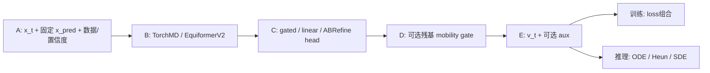

# etflow 模块化架构

入口仍是 `etflow.models.model.BaseFlow`，训练脚本仍是 `scripts/train.py`。新训练配置默认选择 **ABRefine EquiformerV2 + ABRefine SO(2) 等变向量输出头**，保留 TorchMD 供对照实验。

## 一次模型前向：A → B → C → D → E

| 模块 | 输入 | 输出 | 实现 |
|---|---|---|---|
| A 输入准备 | 原子/拓扑、`x_t[N,3]`、固定`x_pred[N,3]`、图时间`[G,1]`、可选置信度 | 居中坐标、动态边`[2,E]`、原子标量特征、边特征、逐原子时间 | `models/conditioning/inputs.py` |
| B 表征 | A 的网络输入 | 标量`h[N,H]`、向量`vec[N,3,H]`；ABRefine 另有高阶球谐上下文 | `networks/factory.py`；`torchmd_net/model_dynamics.py` 或 `representations/abrefine.py` |
| C 输出头 | B 的潜变量 | 未门控速度`v_raw[N,3]` | `heads/linear.py`、`heads/abrefine.py`、`torchmd_net/modules.py` |
| D 残基 mobility | `v_raw`、h、原始结构的键长/碰撞误差、可选置信度、atom→token映射 | 残基gate`[sum(T),1]`、原子gate`[N,1]`、居中后的门控速度`[N,3]` | `models/conditioning/mobility.py` |
| E 返回 | D 的速度；D关闭时为C的速度 | 默认`[N,3]`；`return_aux=True`时返回`(velocity, aux)` | `models/model.py` |

D关闭时不会构造mobility head。B/C在网络包装器中相邻调用，两者独立选择。主入口的forward只保留上述调用，不包含loss、积分或数据检查的细节。



## 目录与职责

```text
etflow/
  data/
    dataset.py                  PT读取及PyG数据封装
    features.py                 RNAFM/原子角色/残基类型 -> 原子标量
    confidence.py               原始置信度 -> 标量/成对/残基摘要
    validation.py               原始样本、batch、跨图边、置信度契约检查
  models/
    model.py                    公共入口/ABCDE调用
    construction.py             配置校验、组件装配、兼容旧构造参数
    conditioning/
      inputs.py                 居中、图构建、置信度融合
      network_features.py       TorchMD当前/原始结构的边、标量、向量初始化
      confidence.py             局部token对 -> batch展平置信度索引
      mobility.py               全局残基编号、残基聚合、gate
    training/
      step.py                   配对增强 -> 路径 -> 模型 -> 终点估计 -> loss -> 指标
      paths.py                  deterministic/stochastic路径及目标速度、时间采样
      augmentation.py           identity/near-native配对（仅train）
      metrics.py                loss及RMS指标记录
    losses/
      regression.py             基础flow matching使用的按图masked L2
      bond.py / clash.py / plane.py   各种几何loss和误差特征
      mobility.py               gate监督/速度预算及mobility项组合
      safeguards.py             no-regret、protect、空选择安全归约
      composition.py            基础loss + 加权可选loss
    loss.py                     旧import路径兼容导出
    sampling/
      integrators.py            固定source与时间循环
      solvers.py                Euler / Heun / Euler-Maruyama独立单步函数
      evaluation.py             暂停dropout并恢复原训练状态
  networks/
    factory.py                  表征/输出头选择与接口适配
    heads/                      可替换向量输出头
    representations/
      abrefine.py               RNA条件化适配
      abrefine_core.py          ABRefine网络组件构建
      abrefine_ops/             本地迁入的球谐/SO(2)/注意力算子和Jd.pt
```

## 显式条件化与置信度

所有训练时间和每个积分步都输入当前`x_t`及固定`x_pred`。推理中的source不会随积分改变。两组坐标分别按图居中；输入PT应已完成预测/native的共同旋转对齐，模型不在forward内做Kabsch。

TorchMD在边上融合当前RBF与原始距离RBF差；标量初始化加入原始邻域及位移/时间编码；向量以`x_t-x_pred`的方向及可学习通道初始化。表征层继续读取原始邻域特征。ABRefine用相同思想初始化`l=0`标量、`l=1`向量和边径向特征，再进入SO(2)注意力和球面前馈层。`source_conditioning: false`提供显式条件化消融。

- `atom_plddt[N]`要求已归一化到0–1；不会自动猜测0–100量纲。
- `token_pair_pae[T,T]`和`token_pair_pde[T,T]`按32 Å裁剪归一化。
- 边置信度为`[PAE(i,j), PAE(j,i), PDE(i,j), contact(i,j)]`。
- `contact_probs[T,T]`裁剪至0–1。四通道按token行均值得到mobility摘要。
- `atom_to_token_idx[N]`保留样本内局部编号。不同样本的`T*T`矩阵展平后拼接，索引使用各图独立偏移；gate使用独立的全局残基偏移。
- `confidence_conditioning`决定模型是否读取置信度；`confidence_strength`在[0,1]内缩放置信度，之后经可学习投影软融合。没有基于置信度的坐标硬替换。
- 彻底关闭置信度：模型设`confidence_conditioning: false`，数据层设`confidence_mode: off`。mobility仍可用映射及几何信息。
- `confidence_mode: required`适合正式置信度实验；`auto`支持整组置信度缺失时零填充。部分缺失在auto下报错。若缺少token映射，数据层使用`residue_index`，这一fallback假设每个RNA残基对应一个token。

## 训练、loss和增强

`flow`模式随机采样t，以条件路径的真实速度为监督。`residual`模式保留旧实验语义：t=0，监督一次位移。两者均保留`flow_matching_loss`，固定权重1；当前基础距离延续旧实现，使用**每个有效原子的向量L2范数，再按图平均**，并非平方MSE。

```text
loss = flow_matching_loss
     + w_bond * bond_loss + w_clash * clash_loss + w_plane * plane_loss
     + w_gate * mobility_loss + w_regret * no_regret_loss
     + w_protect * protect_loss + w_budget * velocity_budget_loss
```

几何项权重0时跳过计算。最后四项只在mobility开启时生效；各项权重可独立设0。mobility目标由输入残基RMS误差在`mobility_good_error`到`mobility_move_error`之间线性映射到[0,1]。no-regret惩罚终点残基误差的增加；protect惩罚原本准确残基的移动；budget限制低gate原子上的未门控速度。所有gate监督只统计`target_mask`有效原子，空选择返回有限零。

identity增强令有效source等于native；near-native增强令有效source等于`native+alpha*(pred-native)`。未观测原子保留source，再按图居中。增强独立于mobility开关，仅在train生效。增强后的source成为该训练配对的固定条件，验证/推理始终使用输入预测结构。置信度保留原预测字段，未生成额外虚构置信度。

## 推理模式

| sampler_type | 行为 | 网络调用次数 |
|---|---|---|
| ode | Euler，无额外噪声 | n_timesteps |
| heun | 二阶Heun，无额外噪声 | 2*n_timesteps |
| sde | Euler-Maruyama，噪声=`std*s_churn*sqrt(dt)*centered_normal` | n_timesteps |
| residual | 一步残差，仅residual训练模型 | 1 |

residual模型为兼容旧调用，无论指定ODE/Heun/SDE均走一次残差，不使用积分步数。建议显式选residual以免误解。SDE是可控随机扰动求解模式，**没有实现score校正，不承诺保持训练路径的理论边缘分布**。训练路径带噪声与推理SDE是两个独立选项。原来的sample虽然接收s_churn/std，实际仅Euler积分，本次补充了真正生效的SDE模式。

无噪声推理会暂停dropout；ABRefine的局部边坐标系改为确定性构造。输出延续旧接口，为按图居中的坐标。需要原始全局平移时，由调用方加回输入质心。ABRefine去除零长度/自环边；整个batch没有任何非零长度边时报错。

## 选择表征与输出头

| representation_type | 可用output_head_type |
|---|---|
| torchmd | gated、linear |
| abrefine | gated、linear、abrefine |

ABRefine后端真正使用迁入的EquiformerV2球谐表示、SO(2)卷积、注意力、球面前馈网络和向量输出块。原蛋白专用的元素/atom-name/残基三路固定拼接改为RNA原子特征投影；不引入抗体专用标签，也不迁入OCP图生成和蛋白旋转/扭角预测任务。原始ABRefine权重不能直接加载此RNA适配网络。

旧TorchMD默认网络参数名保持兼容，可加载相同结构的state_dict；本次显式标量初始化和增强行为有变化，不承诺相同数值轨迹或相同训练结果。切换表征或输出头应重新训练。旧YAML可继续解析。

## 配置、上传和运行

- `config/RNA_train_modular.yaml`：可交给现有train.py的完整示例。先修改data_dir、devices、精度和batch_size。
- `config/MODEL_FIELDS.yaml`：模型、优化器、数据层、采样器及ABRefine参数的默认值和中文说明；这是说明文件，不交给train.py。
- 注意：现有train.py不会读取eval_args做积分验证。`val/refined_rmsd`仍是训练时间采样下的终点估计指标，**不是完整ODE rollout的评估结果**。选择步数应另做完整refinement验证。

上传 `etflow_modular_bundle.tar.gz` 即可；包内包含完整etflow、config、tests、现有train.py/utils.py、说明文件和逐文件清单，不包含数据、检查点或缓存。解压至服务器对应项目目录（会覆盖同名源码，先保留服务器旧版）。已有项目环境除原依赖外需要e3nn；本地验证版本为torch2.8.0 / torch-geometric2.6.1 / torch-cluster1.6.3 / e3nn0.5.1 / lightning2.6.0。torch-cluster须与服务器Torch/CUDA匹配，不要上传本地macOS依赖目录。

```bash
cd /你的服务器/Code_Flow_matching
python -m pip install e3nn==0.5.1
PYTHONPATH=. python -m unittest discover -s tests -p 'test_modular_architecture.py' -v
python scripts/train.py --config config/RNA_train_modular.yaml --no_logger
```

独立推理使用模型API；eval_args可直接传入sample：

```python
import yaml
from etflow.models.model import BaseFlow

with open('config/RNA_train_modular.yaml') as f:
    cfg = yaml.safe_load(f)
model = BaseFlow.from_config(cfg)
# 训练完成后，先加载本次模型的checkpoint，并将model与batch移到相同device。
# model.load_state_dict(torch.load(checkpoint, map_location='cpu')['state_dict'])
refined = model.sample(
    z=batch.atomic_numbers, pos_pred=batch.pos_pred,
    bond_index=batch.edge_index, batch=batch.batch,
    node_attr=batch.node_attr, edge_attr=batch.edge_attr,
    atom_plddt=batch.atom_plddt,
    atom_to_token_idx=batch.atom_to_token_idx,
    token_pair_confidence=batch.token_pair_confidence,
    num_tokens=batch.num_tokens,
    atom_mobility_attr=batch.atom_mobility_attr,
    geometry_bond_index=batch.geometry_bond_index,
    ideal_bond_length=batch.ideal_bond_length,
    clash_exclusion_index=batch.clash_exclusion_index,
    **cfg['eval_args']['sampler_args'])
```

新增的`etflow`模块（包括包内`__init__.py`和`Jd.pt`）是运行依赖，不能直接删除。新增配置、字段说明、文档和测试不参与前向运行，可在不需要对应功能时删除，但建议保留用于复现；压缩包和清单上传/核验后可删除。新增文件的精确列表及用途见`REFACTOR_FILES.md`。

本地通过合成batch的前向/反向传播、两种表征和五种合法头组合、lmax1/2旋转与平移等变性、固定source、多图置信度偏移、路径/增强、关闭置信度、masked mobility及ODE/Heun/SDE检查。尚未运行真实PT训练、GPU混合精度或多卡DDP，不对精修质量改善作结论。
