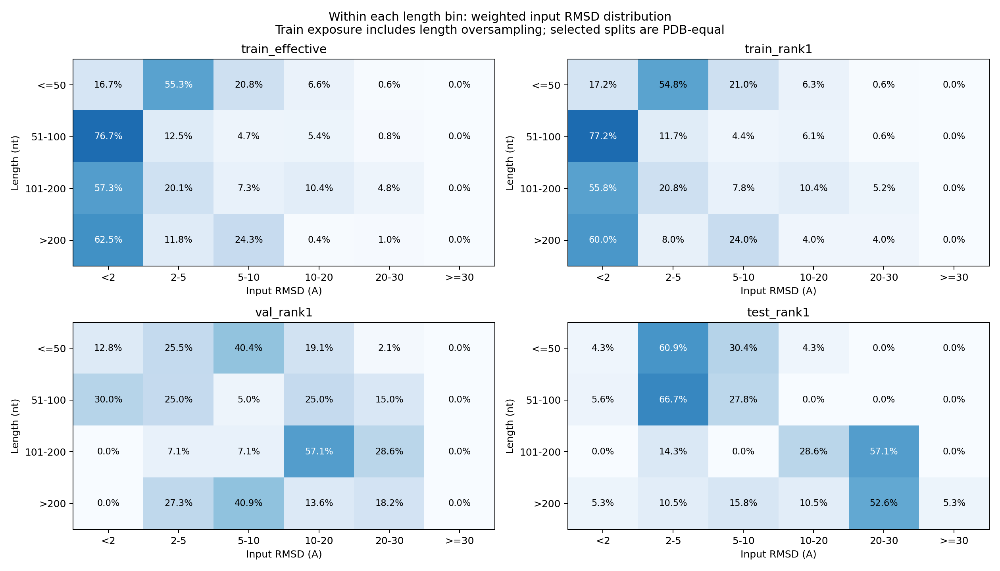

# Data_PT_V2：本地结果解读

结论：训练与测试的监督难度、长度和置信度存在明确差异；最突出的缺口是长 RNA 的大幅构象错误。输入局部二面角分布高度相似，二维降维也未显示整体完全脱离训练区域，不能据此断言模型无法学习。

本报告读取下载的 PT 摘要，不改变数据/模型。下文关联的 epoch49 评估为历史 BF16 修复前结果，不能用它证明分布差异的因果贡献。

## 1. 输入质量和长度

| 指标 | 训练实际采样 | 训练 rank-1 | 验证 rank-1 | 测试 rank-1 |
|---|---:|---:|---:|---:|
| 平均长度 nt | 74.2 | 59.8 | 138.3 | 146.0 |
| 平均输入 RMSD Å | 3.645 | 3.977 | 9.350 | 10.427 |
| 平均残基 pLDDT (0–1) | 0.892 | 0.897 | 0.841 | 0.813 |
| 每1000原子碰撞对 | 35.30 | 36.02 | 41.78 | 46.98 |
| α 对 native 圆周误差 ° | 30.59 | 33.29 | 38.19 | 40.75 |
| γ 对 native 圆周误差 ° | 25.36 | 27.93 | 30.48 | 33.77 |

统一候选选择规则后，测试与训练 rank-1 的 RMSD 均值差仍为 6.450 Å，PDB bootstrap 95% 区间 [4.229, 8.974]。这不是主要由 200 候选 vs rank-1 造成的表观差异。

## 2. 最明显的缺口：长链 × 大误差

- 训练 >200 nt：25 个 PDB、4,650 个 PT，实际采样占比 4.49%；测试为 19/67 = 28.36%。
- 训练长链 RMSD 均值 3.202 Å，测试长链为 19.231 Å。
- 训练长链 RMSD ≥10 Å：仅 65/4650 = 1.40%，来自 5 个 PDB（3DHS, 4C4Q, 5G2Y, 6WLT, 6WLU）；测试长链为 13/19 = 68.42%。
- 长链且 RMSD ≥10 Å 在全训练曝光只占 0.063%，但在整个测试集中占 19.40%。单纯把所有 >50 nt 样本加权 2 倍，不能补足这类任务。
- 13 个困难长链测试目标中，有 8 个在输入摘要空间的最近训练 PDB 是 4C4Q/5G2Y，这两个 PDB 分别只保留 10/40 个候选。最近邻可找到类似样本，不表示训练经常看到这些样本；参考集每 PDB 最多 8 个候选也不是实际采样频率。详见 hard_long_test_neighbors.tsv。
- 大量近似候选来自少数 PDB，增加候选数量不等于增加独立结构/家族覆盖。



## 3. 验证集与训练集序列重叠

共 9 种 PT 序列跨集合出现，涉及 21/103 个验证 PDB；原始 exact_split_overlaps.tsv 无跨集合同名 PDB，也无测试集完全相同序列命中。序列是 PT 建模使用的 canonical 序列，不能替代 native/完整同源审计。

| 验证子集 | PDB 数 | 平均输入 RMSD Å | 输入 <2 Å 个数 | 历史 epoch49 平均改善 Å |
|---|---:|---:|---:|---:|
| 未命中完全相同序列 | 82 | 10.900 | 0 | 0.287 |
| 与训练序列相同 | 21 | 3.300 | 12 | 0.988 |

这不意味着原时间划分执行错误：项目单独对测试集做了去同源，验证集的定义与测试集不同。验证集不能直接当作新序列泛化评估。未完全相同的 82 个验证 PDB 仍可能近同源，不应命名为严格 novel。

建议保留历史全集成绩，再固定报告 seen-sequence / unmatched-exact-sequence 两个面板。对未来训练，在训练 PDB 内按已有同源簇留出严格验证、保持每 PDB rank-1；不要把相同 PDB 候选拆到训练与验证。不能针对本次测试结果重划分出更容易的测试集。

## 4. 降维、二面角与覆盖

- 无 native 输入摘要，val 超过训练跨 PDB 最近邻距离 q95：5/103 = 4.85%。这是特征依赖的参考标记，不是不可学习概率。
- 无 native 输入摘要，test 超过训练跨 PDB 最近邻距离 q95：3/67 = 4.48%。这是特征依赖的参考标记，不是不可学习概率。
- 均值 RNA-FM，val 超过训练跨 PDB 最近邻距离 q95：7/103 = 6.80%。这是特征依赖的参考标记，不是不可学习概率。
- 均值 RNA-FM，test 超过训练跨 PDB 最近邻距离 q95：10/67 = 14.93%。这是特征依赖的参考标记，不是不可学习概率。
- 九类输入二面角边际分布的圆周 Wasserstein 距离为 0.35–2.93°（12 箱近似）；图形高度重合。但相对 native 的角误差变大，两者描述的问题不同。
- 这更支持全局构象/结构域安排和大误差监督稀缺的假设；边际角分布相似不保证长程相互作用、角度相关性或 native 分布相似。
- input PCA 前两维解释约 39.9%，RNA-FM PCA 约 27.6%；二维重合不能排除其余维度的偏移。

## 5. 历史模型效果的关联（有限证据）

已按 split/PDB/seed/sample 匹配全部 170 个候选，并核对输入 RMSD。

| 特征空间 | 测试子集 | PDB 数 | 历史平均改善 Å | 历史中位改善 Å |
|---|---|---:|---:|---:|
| input | 参考 q95 内 | 64 | 0.0792 | 0.0031 |
| input | 超过参考 q95 | 3 | 0.0062 | 0.0033 |
| rnafm | 参考 q95 内 | 57 | 0.0904 | 0.0074 |
| rnafm | 超过参考 q95 | 10 | -0.0064 | -0.0089 |

均值 RNA-FM 较远的少数目标效果更差，值得验证；但输入摘要距离较近的大多数目标也几乎没有改善，不能用 OOD 几个目标统一解释失败。小组样本少、长度/质量混杂，且历史 BF16 数值错误尚在训练和推理中；不作因果结论。

## 6. 数据质量与后续实验

- 抽取错误 0、缺 ranking_score 0、与归档可核验排名不一致 0、存储/重算 RMSD >0.01 Å 不一致 0。
- val 完整 200 候选为 97/103 个 PDB，test 为 55/67 个。rank-1 只承诺在现有 PT 集合中选最高分。
- 7ZJ4 的测试输入 RMSD 为 41.663 Å，归档 200 候选均 >30 Å；train 所有 PT ≤30 Å。保留该目标作为明确的困难/范围外子集，不静默删除。其 PT metadata 的 dataset_rmsd_limit 仍为 30，需要追溯保留策略。
- 训练部分 PDB 的候选显著不足，不能假定每 PDB 具有同等曝光：2LKR=196; 2N1Q=174; 4C4Q=10; 5G2Y=40。低计数具体原因应追溯生成/筛选日志。
- 原 ranking_score 图被两个约 −99 的训练候选拉伸；常规分数挤在右端。应查看数值表或只缩放显示常规区间，不把图中压扁误读为分布一致。

后续顺序：先在修复 BF16 路径后作统一复评；再固定无同源泄漏的选模验证；最后开展长度×误差分层采样/真实困难训练 PDB 增补的受控对照。若用 native RMSD 构造训练采样权重，说明它是训练标签，不用于推理时筛选。保留近 native 训练和保护验证，防止增加困难样本后破坏好输入。
不要只将已有 5 个困难长链 PDB 的候选反复放大就声称覆盖已补足，也不要直接改为训练仅 rank-1：选择效应并非主要差距，训练 rank-1 的全局误差仍很低。

## 复现与新增文件

本地命令：

```bash
python scripts/summarize_dataset_shift_results.py --result-dir "C:\Users\49586\Desktop\Learning\Laboratory\Admis\graduate_first\RNA\Code_Flow_matching\evaluation\dataset_shift_20261014_084658" --historical-eval-root "C:\Users\49586\Desktop\Learning\Laboratory\Admis\graduate_first\RNA\Code_Flow_matching\evaluation\v3_rank1_epoch49_20261008"
```

新增脚本 scripts/summarize_dataset_shift_results.py 和本 local_interpretation/ 下的报告、PNG、TSV；全部不参与训练，保存复现记录后可删除。本次不需要上传或执行服务器命令。
