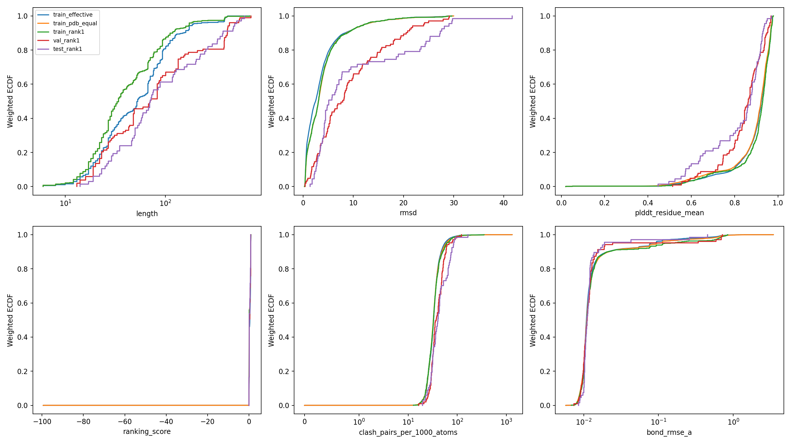
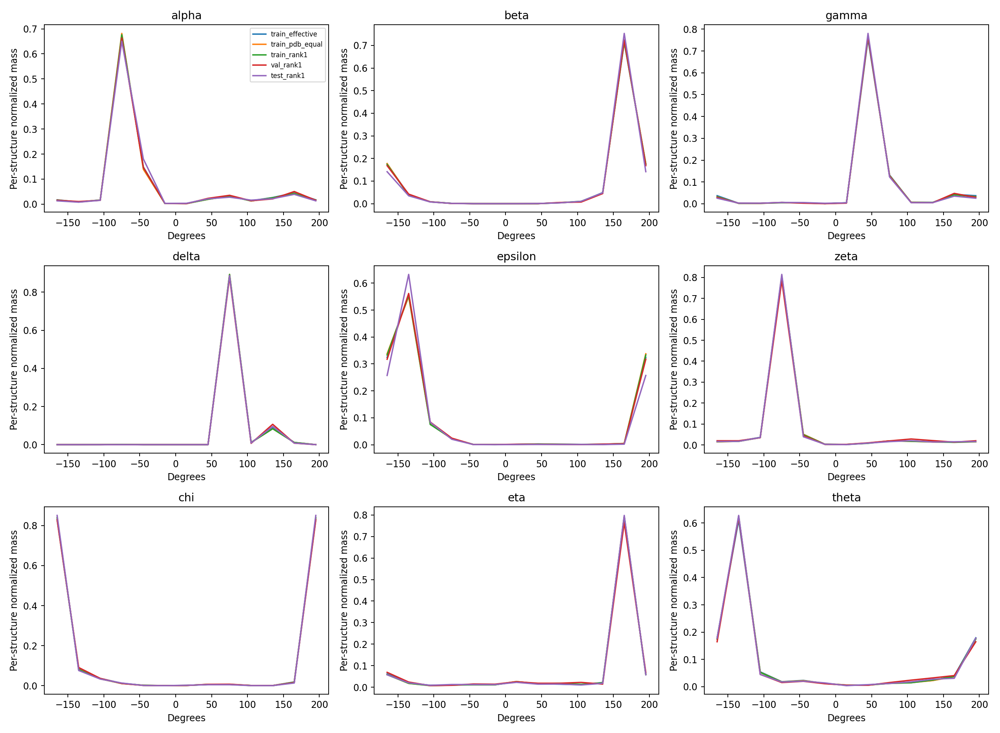
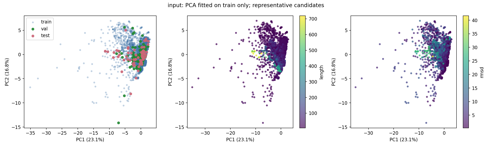
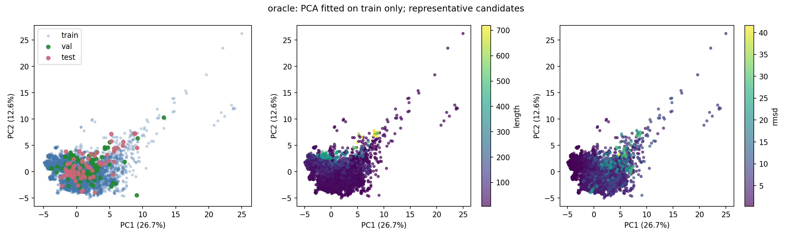

# 数据集分布诊断

输入为现有 PT；不修改数据、划分、候选或模型。val/test 使用已经冻结的最高 ranking_score 候选。

| 分布 | PT 数 | PDB 数 |
|---|---:|---:|
| train_candidates | 151220 | 758 |
| train_effective | 151220 | 758 |
| train_pdb_equal | 151220 | 758 |
| train_rank1 | 758 | 758 |
| val_rank1 | 103 | 103 |
| val_all_pdb_equal | 19722 | 103 |
| test_rank1 | 67 | 67 |
| test_all_pdb_equal | 12310 | 67 |

训练采样：长度 >50 nt 的候选权重为 2.0；其余为 1。与 V3 配置一致时才代表实际训练曝光。

## 需要先核对

- Exact PDB/sequence overlap detected. Sequence matches do not replace a homology-cluster audit.
- 当前集合 RMSD >30 Å 的候选：1；存储/重算 RMSD 差值 >0.01 Å：0。

## 分布差异最大的指标（按 KS 幅度排序）

| 比较 | 指标 | KS | 均值差：目标−训练 | PDB bootstrap 95% CI |
|---|---|---:|---:|---|
| test_rank1 | residue_error_q90 | 0.464 | 10.4 | [7.18, 13.8] |
| val_rank1 | rmsd | 0.463 | 5.71 | [4.29, 7.03] |
| val_rank1 | stored_rmsd | 0.463 | 5.71 | [4.29, 7.28] |
| test_rank1 | rmsd | 0.433 | 6.78 | [4.22, 9.12] |
| test_rank1 | stored_rmsd | 0.433 | 6.78 | [4.47, 9.67] |
| val_rank1 | residue_error_q90 | 0.409 | 8.39 | [6.3, 10.8] |
| test_rank1 | alpha_error_mean_deg | 0.406 | 10.2 | [6.6, 13.7] |
| test_rank1 | gamma_error_mean_deg | 0.404 | 8.42 | [5.36, 11.8] |
| val_rank1 | pde_mean | 0.401 | 0.633 | [0.345, 1.03] |
| val_rank1 | plddt_q10 | 0.395 | -0.083 | [-0.107, -0.0578] |
| val_rank1 | plddt_residue_mean | 0.395 | -0.0513 | [-0.0725, -0.0288] |
| val_rank1 | plddt_mean | 0.393 | -0.0512 | [-0.073, -0.0323] |

## 解释边界

- train_effective 是按 PT 采样且长链加权；train_pdb_equal 每个 PDB 等权；train_rank1 是训练端也选最高分，用于识别选择效应，未改变训练数据。
- 标准化、缺失值填补、PCA 和可选 UMAP 只拟合训练参考。input 空间是无 native 的输入摘要，不含 ranking_score；oracle 空间含 RMSD/二面角误差，属于监督难度诊断。RNA-FM 空间每个 PDB 一个均值向量。二面角降维使用 sin/cos 的一、二阶矩，跨 ±180° 连续。这些摘要不是模型完整输入。
- input_coverage.tsv 在完整输入特征空间计算最近距离，以训练中跨 PDB 距离的第 95 百分位作参考阈值。二维图分开不等于不可学习；图重合也不证明覆盖充分。
- clash 为重原子 0.8×范德华半径和阈值，排除 PT 的 1–2/1–3 配对；统计全部邻居、不截断到 64，因此不是训练 clash loss 或 MolProbity clashscore。
- 二面角按 12 箱周期直方图比较；native 误差取圆周最短距离，缺原子、序列断点和退化角不计为零。每结构先归一化，避免长链天然占更大权重。
- bootstrap 重采样整个 PDB，保留其候选；不同 PDB 的同源性未消除。没有把数万个候选当独立样本给出 KS p 值。
- RMSD >30 Å 的保存策略、部分 PDB 不足 200 个候选会影响分布。rank1 比较仅覆盖现有可用 PT；不能宣称已核实原始所有 200 个预测。
- 当前模型已有 BF16 图均值错误记录。分布差异和该数值问题应分别检验；本报告不能给出模型差的因果结论。

## 后续验证

保持 val/test PDB 划分。用 val_rank1 选 checkpoint/早停，用归档 val 全候选作稳定性面板；同时考察宏平均 RMSD 改善、低误差输入回退率和局部几何恶化。按长度、置信度、输入误差固定分层，并报告每层 PDB 数。
测试集用于本次已声明的事后诊断，不能继续承担调参/选权重。若后续针对测试集暴露的问题反复迭代，需要新的独立终测集。

