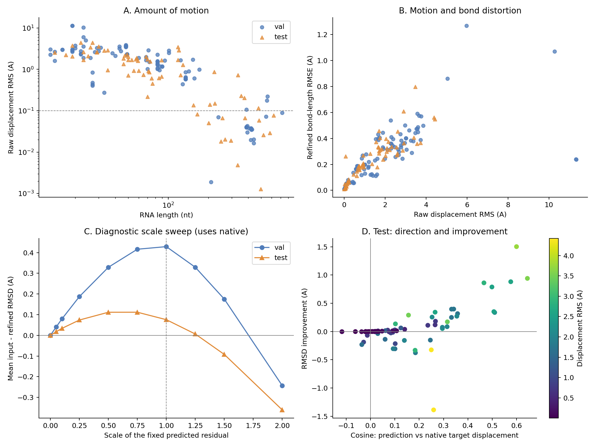
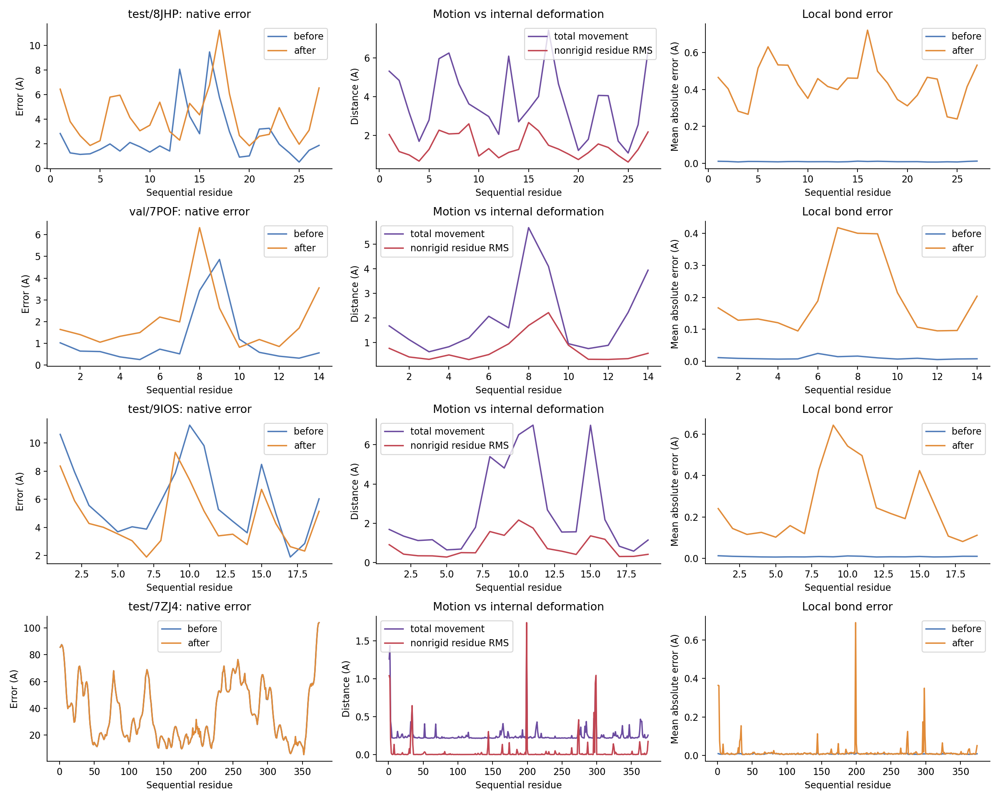

# 本地 rank-1 三结构诊断：epoch 49

**2026-10-13 更新：服务器已确认 CUDA BF16 图均值错误，大图计数停在 256。下文结构测量描述原导出文件，仍可用于记录现象；原梯度的机制解释需要在修复后重新检验。先修复和复评，再调整 loss。** 见[修复说明](../../scripts/FP32_GRAPH_MEAN_FIX.md)。

数据：`RNA/pymol_bundle`，验证集 103、测试集 67，每个 PDB 一个已选候选。分析的是本次实际下载的输出，数值与之前运行的报告有轻微 BF16/重新推理差异。本次测试集全原子 RMSD 为 10.426974 → 10.351303 Å。

## 结论

“多种限制 loss 让模型不敢动，稍微动一个就导致整体崩掉”只能解释部分现象，不能作为统一结论。数据支持三个同时存在的问题：

1. **长 RNA 的修正幅度明显收缩。**>200 nt 的测试链平均移动 RMS 只有 0.151 Å；对应短链 ≤50 nt 为 2.467 Å。
2. **部分短链的修正幅度过大，或方向不对。**8JHP 的原子移动 RMS 达 4.422 Å；7POF 为 2.663 Å，均不是“只动了一点”。
3. **输出不是保持残基化学结构的协调移动。**同一残基的原子被不同地拉动，键、碱基环和糖环随之变形。整体 RMSD 和平均几何 loss 会稀释少数严重局部损坏。

哪些训练 loss 导致长链收缩，现有导出文件无法直接判定。用户后来提供的五目标探针已经显示：7ZJ4 与 9C6J 的 gate 没有整体关闭，门控前输出本身很小；7POF 的 gate 相对于监督标签过大。参数梯度文件现已收到：7ZJ4 有明显 no-regret 冲突，而其他四目标没有同类冲突。详见[五目标梯度分析](../rank1_mobility_probe_20261013_104047/梯度分析.md)。局部梯度尚不能替代训练消融。

## 补充：服务器门控探针结果

用户执行目录：`evaluation/rank1_mobility_probe_20261013_104047`，BF16，固定 epoch 49。

| PDB | raw 输出 RMS (Å) | 门控后 RMS (Å) | gate 均值 | gate 监督目标均值 |
| --- | ---: | ---: | ---: | ---: |
| 7POF | 2.9659 | 2.6620 | 0.7941 | 0.3566 |
| 7ZJ4 | 0.3295 | 0.3179 | 0.9079 | 1.0000 |
| 8JHP | 4.9414 | 4.4312 | 0.8679 | 0.8836 |
| 9C6J | 0.001935 | 0.003506 | 0.7483 | 0.7032 |
| 9IOS | 3.9448 | 3.7323 | 0.8485 | 1.0000 |

- 7ZJ4 的门控只把输出 RMS 降低约 3.5%；仅 2/374 个 gate <0.01，protect 为 0。它主要缺少门控前的有效向量输出，不能解释为 gate 冻结全链。
- 9C6J 的 raw 输出也只有约 0.002 Å，gate 均值却为 0.748。原始输出过小的现象同样存在。
- 7POF gate 最小值都为 0.641，而 28.6% 残基的输入误差 <0.5 Å。按当前监督定义，这些保护残基的 gate 目标最多约 0.167。这是门控对高质量局部结构过于激进的直接证据。
- 8JHP 的 gate 均值与标签均值接近，但 raw 修正达 4.94 Å，输出过冲/内部形变主要已存在于向量预测中。
- 9C6J 的门控后/前 RMS 比值 1.812 是需要复核的数值异常：理想实数计算中，0≤g≤1 的乘法再去质心不应增大总 RMS。不能把该比值解释成 gate 有放大机制。探针已增加 FP32 参考门控、返回向量质心和 dtype 字段，用于区分 BF16 归约误差与其他实现问题。

`loss_gradients.tsv` 已收到并分析：7ZJ4 的加权 no-regret 参数梯度达到坐标项的 77.2%，余弦 −0.695；其他四目标的 no-regret 余弦为正。velocity budget 参数梯度在五目标上均较小。应优先验证特定目标的 no-regret 冲突，不能统一归因为所有限制项。

## 1. 模型究竟动了多少

“移动 RMS”是在共同原始输入坐标系中，精修前后原子位移的 RMS，不是两个分别拟合后的结构之间的距离。下面先对每条链计算，再对链等权平均。

| split | 链长 | 链数 | 平均移动 RMS (Å) | 每链移动 RMS 的中位数 (Å) |
| --- | --- | ---: | ---: | ---: |
| val | ≤50 nt | 47 | 3.270 | 2.961 |
| val | 51–100 nt | 20 | 1.506 | 1.452 |
| val | 101–200 nt | 14 | 1.110 | 0.754 |
| val | >200 nt | 22 | 0.0567 | 0.0386 |
| test | ≤50 nt | 23 | 2.467 | 2.320 |
| test | 51–100 nt | 18 | 1.159 | 0.925 |
| test | 101–200 nt | 7 | 1.468 | 1.275 |
| test | >200 nt | 19 | 0.151 | 0.0666 |

测试集 33/67 个目标的移动 RMS >1 Å，只有 13/67 个 <0.1 Å。验证集对应为 65/103 和 19/103。因此整体模型不是统一处于静止状态。



长链分布值得优先检查，但长度与结构类型、训练分布和置信度相关，不能仅凭这个相关性认定代码中存在按长度硬截断。

## 2. 两个非常具体的化学损坏

### 8JHP：27 nt，原子输出大幅移动并发生内部形变

- 原子移动 RMS 4.422 Å，中位数 3.092 Å；95.1% 原子移动 >1 Å，52.4% >3 Å。
- 整体 RMSD：3.2507 → 4.6384 Å。
- 第 1、2 个残基平均移动 5.314、4.838 Å。
- 第 6 个残基的 C6—N6：native 1.337 Å、输入 1.343 Å、输出 **3.928 Å**。
- 第 16 个残基 C2′—O2′：输入 1.418 Å、输出 **3.703 Å**。
- 对每个残基做“输入残基到输出残基的最佳刚体拟合”，剩余形变的原子加权 RMS 为 **1.592 Å**。这说明移动包含显著内部变形，不能解释成整个残基一起平移或转动。

这几条键的 native 和输入长度互相吻合，支持原子映射和输入几何是合理的；输出的异常不是 PyMOL 猜键导致。

### 7ZJ4：374 nt，整体几乎不变，但少量局部严重受损

- 93.2% 原子移动 <0.1 Å，中位位移只有 0.0209 Å。
- 整体 RMSD：41.6628 → 41.6592 Å，仅改善 0.0036 Å。
- 但最大原子位移 **5.433 Å**，第 199 个残基平均位移 **1.482 Å**。
- 第 199 个残基 C2—N3：native 1.329 Å、输入 1.331 Å、输出 **3.888 Å**。
- 该残基的平均绝对键长误差从 0.00773 → **0.6903 Å**；碱基平面 RMS 厚度从 0.00303 → **0.3335 Å**。

这里更准确的描述是“大部分不动，少量原子出现异常修正”，而不是整个长链发生统一崩塌。少量坏键会被数千个原子的全局平均稀释。

可直接打开本目录的 `8JHP_residue6_bond.pse` 或 `7ZJ4_residue199_bond.pse` 查看三对象。它们沿用全链全原子拟合；长链对应残基的 native 与预测可能相距很远，因为域位置本来就错了。判断键长时读数值，不要把整体叠合失败当作局部对齐错误。



## 3. 约束是否把模型压得不敢动

源码中的各项作用不同，不能因为项数多就合称“过强限制”。

| 项 | 当前作用 | 本次能判断的内容 |
| --- | --- | --- |
| mobility gate | 每残基一个标量，乘以该残基每个原子的原始向量输出 | 可压小输出，但 gate 数值没导出，尚不能确认长链是否因 gate 被压住 |
| mobility supervision | 原残基误差 ≤0.3 Å 的目标为 0，≥1.5 Å 为 1 | 长链目标值均值很高：val >200 nt 为 0.936，test 为 0.968；标签总体是在要求它们移动 |
| protect | 只惩罚原残基误差 <0.5 Å 的可观测原子的移动 | 长链平均仅约 0.45%–0.46% 残基命中，不支持“protect 直接冻结绝大多数长链残基” |
| no-regret | 惩罚相对 native 的逐残基误差增加 | 可能使不确定方向的修正偏保守，需要加权梯度核对 |
| velocity budget | 以 `(1-g.detach()) * ||raw_velocity||²` 惩罚低 gate 区域的原始输出 | 存在低 gate 与小原始输出相互强化的可能；这是待检验机制 |
| bond / clash / plane | 输出的软几何惩罚 | 没有保证残基刚性，观察到的几何损坏说明其现有训练结果不足以保护结构 |

**关键区别：同一残基所有原子用相同 gate，不等于它们一起做刚体移动。**实际结构为 `x'_i = x_i + g_r * v_i`（另有去质心），每个原子的 `v_i` 可以不同。因此同一碱基环依然可以被撕开。去质心只消除整体平移，不会修复原子间的相对位移。

测试集可从坐标重建的链平均损失：

- 坐标项：输入 8.7756，输出 8.7589，数值改善约 0.0167。
- 加权三项几何：输入 0.000432，输出 0.009290。
- 输出加权 no-regret：约 0.08656。
- 输出加权 protect：约 0.004318。

这提示 no-regret 对测试输出的惩罚比三项几何的数值更显著，但**损失数值大小不等于梯度大小**，也不能由测试上的端点值推断训练因果。gate supervision 与 raw velocity budget 的损失未在 bundle 中保存，完整目标不能重建。

源码的坐标项是 `mean(||预测残差−目标残差||₂)`，不是 MSE，也不是重新拟合后的 RMSD。其单原子梯度大小不会随目标误差增大而同比增长；每条图还按观测原子数归一化。应核对其和正则的梯度关系，不能把名称 `flow_matching_loss` 默认理解成标准 squared flow matching。

## 4. 缩放输出：过冲和方向错误可以区分

固定已生成的残差，计算 `x(α)=before+α(after-before)`，每个 α 都重新对 native 全原子拟合。不修改模型或输入选择。

| 目标 | α=0 | α=0.25 | α=1 | α=2 | 解释 |
| --- | ---: | ---: | ---: | ---: | --- |
| 8JHP | 3.2507 | 3.1402 | 4.6384 | 8.2597 | 小幅沿现有方向能改善，但当前输出严重过冲 |
| 7POF | 1.7288 | 1.5625 | 2.4043 | 4.6872 | 较好的输入被过大的修正拉差 |
| 9IOS | 6.4937 | 5.9696 | 4.9905 | 5.5843 | 方向有用，α 太小会损失改善 |
| 7ZJ4 | 41.6628 | 41.6618 | 41.6592 | 41.6566 | 把当前输出放大也几乎修不好整体折叠 |

测试集 α=1 平均改善 0.0757 Å，α=0.5 为 0.1116 Å，α=2 变为 **恶化 0.3604 Å**。即使减半，平均收益仍很小，因此问题不只是步长。

8VT5 的当前输出方向和目标位移的总体余弦为 -0.028；在本次非负缩放网格中，α=0 最好。单纯增加移动幅度会放大错误方向。

**上述 α 结果使用了 native，属于事后诊断；不能据此在测试集挑选部署 α 或声称获得新的泛化性能。**后续修改的参数只能用验证集确定。

## 5. 只修残基内部形变会怎样

诊断性操作：用输入和输出，把每个输入残基作为刚体拟合到对应输出残基，替换掉输出内部变形。拟合变换不使用 native；native 仅用于随后计算评估值。

| test 链平均 | 输入 | 原输出 | 残基刚体投影后 |
| --- | ---: | ---: | ---: |
| RMSD (Å) | 10.4270 | 10.3513 | 10.3629 |
| 键长 loss (Ų) | 0.004218 | 0.080400 | 0.033866 |
| 碱基平面 loss (Ų) | 0.00000457 | 0.009806（约） | 0.00000457 |

只付出约 0.0116 Å 的平均 RMSD 差，就能消除这类残基内部平面变形，说明大量局部形变对整体改善不是必需的。跨残基键和碰撞尚未被该操作保证；整个核苷酸刚体还会限制糖环/主链真实柔性，不能直接把这个诊断投影当作最终模型。

这支持优先改变输出的几何表达，例如碱基刚体、受约束主链或几何投影，而不是先删除所有几何损失来“让模型敢动”。

## 6. 确认根因的下一步

已准备服务器脚本 `Code_Flow_matching/scripts/probe_rank1_mobility_gradients.py`。上传到服务器同名目录后执行：

```bash
conda activate protenix-1.0.5
cd ~/Code_Flow_matching
CUDA_VISIBLE_DEVICES=0 python scripts/probe_rank1_mobility_gradients.py \
  --pdb 8JHP 9IOS 7POF 7ZJ4 9C6J --parameter-gradients \
  --output "evaluation/rank1_mobility_probe_$(date +%Y%m%d_%H%M%S)"
```

不进行 optimizer step。输出 `gates.tsv` 和 `loss_gradients.tsv`：

- raw 输出大、gate 很小：门控确实压制了动作。
- raw 本身很小、gate 不小：问题主要在向量预测能力/学习结果。
- 低 gate 与小 raw 同时出现：符合门控与 budget 相互强化的候选机制，仍需训练消融验证。
- 正则加权参数梯度比坐标项大、且余弦为负：该样本该 checkpoint 上有直接的梯度冲突证据。

该脚本已由用户在服务器执行，五目标门控及参数梯度文件均已下载并分析。单个 checkpoint 的梯度也不是训练消融的替代。脚本的分图居中参数曾有错误，已修正并增加回归测试。

建议先取这组观测，再设计少量验证集消融：分别调整 no-regret/budget、保留必要几何约束、加入可保持局部结构的输出方式。评价同时看 RMSD、明显恶化率、最大键长错误和高分位错误，不能只监控平均 RMSD。长链还要检查是否缺少修复全局域关系的能力；当前六层 6 Å 邻域消息传递及局部边置信度并不显式保证全局折叠修复能力。

## 文件与复现

- `target_diagnostics.tsv`：每 PDB 的移动量、方向余弦、保护比例、几何误差和投影结果。
- `group_diagnostics.tsv`：按 split、链长、输入误差等分组的链平均。
- `residue_diagnostics.tsv`：逐残基的位移、非刚体形变和理论 gate 标签。
- `residual_scale_sweep.tsv`：固定输出的 α 扫描，仅用于诊断。
- `movement_and_geometry.png`、`representative_residue_diagnostics.png`：统计图。
- 两组 `*_bond.png/.pse`：局部坏键的 PyMOL 视图。

复现命令：

```text
python Code_Flow_matching/scripts/analyze_rank1_pymol_mechanism.py
```

170 个目标均已核对：由 source_frame CIF 重算的输入/输出 RMSD 与 manifest 差异 <0.001 Å；重建的训练 target 坐标系也与导出的 frame RMSD 相符。未修改原 bundle、模型或训练配置。
