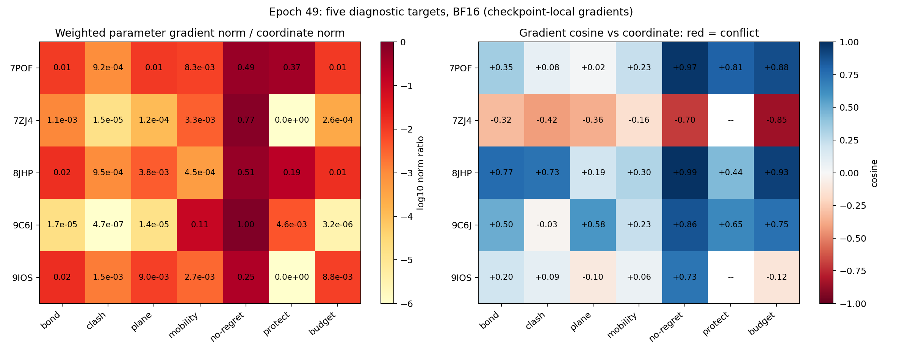

# Epoch 49：五目标损失梯度诊断

**2026-10-13 更新：本报告的梯度来自已确认存在 CUDA BF16 图均值错误的计算路径。数值作为旧路径记录保留，不能据此认定正常计算下的 no-regret 冲突强度、几何项比例或网络梯度敏感性。修复后需重新运行探针。** 见[修复说明](../../scripts/FP32_GRAPH_MEAN_FIX.md)。

数据：本目录 `gates.tsv`、`loss_gradients.tsv`，BF16。比较的是全部模型参数上的欧氏梯度范数，**已乘训练权重**，不要再给 no-regret 乘一次 0.5。

## 主要判断

7ZJ4 存在强 no-regret 与坐标项梯度冲突，其他四目标的 no-regret 梯度与坐标项总体同向。三项几何和 velocity budget 不是本次主导的参数梯度阻力。“所有约束太强导致不动”不能作为统一解释。

| PDB | 坐标梯度范数 | no-regret 范数 | no-regret/坐标 | 余弦 | 当前含义 |
| --- | ---: | ---: | ---: | ---: | --- |
| 7POF | 20.340 | 9.873 | 48.5% | +0.971 | 总体同向，帮助纠正当前坏输出 |
| 7ZJ4 | 87.888 | 67.888 | 77.2% | **−0.695** | 显著竞争 |
| 8JHP | 73.494 | 37.490 | 51.0% | +0.990 | 当前几乎完全同向 |
| 9C6J | 0.671 | 0.669 | 99.7% | +0.860 | 很强但同向，不能解释为抵消 |
| 9IOS | 23.600 | 6.012 | 25.5% | +0.730 | 总体同向 |

余弦 <0 表示沿某一项的负梯度做小步更新，在一阶近似下会增加另一项；>0 表示下降方向总体兼容。这是当前 checkpoint、当前样本的局部导数，不是整个训练过程的因果结论，也不是 AdamW 更新方向的精确模拟。



## 7ZJ4：具体冲突来自 no-regret

gate 均值 0.908，仅把输出 RMS 从 0.329 压到 0.318 Å。gate 未整体关闭。

no-regret 在坐标梯度方向上的相对投影为 `0.7724 × (−0.6953) = −0.5371`，抵消该方向约 **53.7% 的分量**。算上其他项，这个方向剩约 46.2%。这不是“移动幅度减少 53.7%”；只合成坐标项和 no-regret 时，梯度总范数仍有坐标项的约 72.3%，因为存在垂直分量。

budget 范数 0.02283，只占坐标项 **0.026%**；protect 为零；三项几何范数之和只占 **0.127%**。不支持它们联合全面压制输出的说法。

no-regret 本来就会惩罚某些残基变差。对于多个区域需要协调重排的结构，逐残基“不许变差”和整体坐标误差下降可能竞争。这是应优先验证的机制，但当前梯度不能证明减小权重就能修复长链。

## 9C6J：几乎不动，却不是同一种冲突

raw RMS 只有 0.00194 Å，gate 均值 0.748。no-regret 与坐标项余弦 +0.860；budget 和几何参数梯度极小。当前样本不支持 no-regret 抵消坐标项导致静止。

原始输出端坐标梯度范数为 0.04885，与 7ZJ4 的 0.04526 接近；传到参数空间却只有 0.671，对比 7ZJ4 的 87.888。这提示需要检查网络对该输入的方向敏感性、梯度聚合/抵消和中间向量特征。本次统计不能区分这些原因。

门控后 RMS 大于门控前，是独立数值异常。理想 gate+去质心不应增大总 RMS；BF16 归约需要用 FP32 复核，不能将比值 1.812 解释成门控放大机制。

## 短链坏输出与几何项

7POF 的 no-regret、protect 余弦分别 +0.971、+0.809；8JHP 对应 +0.990、+0.441。它们在当前点总体帮助坐标项纠错，过冲不能解释为这些正则正在反向阻碍坐标项。

损失在训练更新参数时发挥作用，推理并不会自动最小化它们或硬拒绝坏输出。存在 protect loss 不等于推理结构被硬保护。

7POF 的 gate 目标均值 0.357，预测为 0.794；mobility 监督的参数梯度只占坐标项 **0.83%**。这提示应检查门控校准强度，但不能凭一条样本决定权重。

三项几何参数梯度范数之和/坐标项：7POF 2.26%、7ZJ4 0.127%、8JHP 1.99%、9C6J 0.00313%、9IOS 2.67%。这只是合成范数的上界，不是实际合成范数。总体参数梯度小也不代表每个原子、每层都小；但不支持将它们视为本次主要全局冲突来源。已有坏键和平面变形，更支持保留并改进几何保护。

## 小 loss 不等于小梯度

7ZJ4 加权 no-regret loss 只有 0.02095，坐标 loss 为 35.699，但梯度范数分别为 67.888、87.888。9C6J 加权 no-regret loss 只有 0.000466，梯度仍达到坐标项的 99.7%。

no-regret 使用 `relu(输出残基误差−输入残基误差)`。违反量可以很小，活跃区域的导数却不必小。判断损失是否主导，应看加权梯度而非只看曲线数值。

## 最小验证顺序

1. 先对 7ZJ4、9C6J 做 FP32 复核，确认冲突方向和门控 RMS。新版探针还给出 FP32 参考门控、输出质心与 dtype。
2. 下一轮优先用验证集做 no-regret 单因素比较，例如 0.5、0.1、0；同时检查短链恶化率、长链收益和局部几何。不能据五个局部梯度直接保证泛化改善。
3. 另行处理输出的几何表达。原子独立修正和残基标量 gate 不保证键角、环结构及主链连接。保持局部形状的输出/投影，以及极端坏键指标，值得优先研究。

服务器 FP32 命令：

```bash
conda activate protenix-1.0.5
cd ~/Code_Flow_matching
CUDA_VISIBLE_DEVICES=3 python scripts/probe_rank1_mobility_gradients.py \
  --pdb 7ZJ4 9C6J --parameter-gradients --precision fp32 \
  --output "evaluation/rank1_mobility_probe_fp32_$(date +%Y%m%d_%H%M%S)"
```

本次只分析下载文件，没有修改训练配置或权重。`scripts/summarize_rank1_probe_gradients.py --probe-dir <目录>` 可复现归一化表、投影和图。
